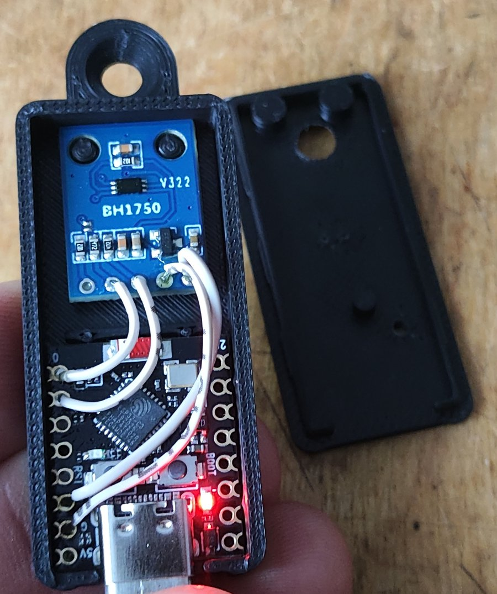

# Case for the light sensor (optional)

A small wall case for the sensor in [`firmware/`](../../firmware/): an ESP32-C3 Super Mini at the
bottom with its USB-C facing down, and the GY-302 above it. The case hangs on one screw through the tab
at the top. It has a window over the BH1750 and a small one over the blue LED of the board.

Outside size: 22 × 48.5 × 9.7 mm; with the tab, 59.5 mm long.

## Files

The STL files are already oriented for printing.

| File | What it is |
|---|---|
| `yarilo-case-base.stl` | the base with the pocket for the Super Mini, pins for the GY-302 and the tab |
| `yarilo-case-lid-soft.stl` | lid with one dimple inside: snaps on more easily |
| `yarilo-case-lid-tight.stl` | lid with two dimples inside: holds tighter |

Print both lids and keep the one that snaps on and does not wobble.

## Printing

Tested in ABS with a 0.4 mm nozzle, 0.12 mm layers, 4 walls and 100 % infill.

There are no screws inside. The boards and the lid are held by small crush ribs and snaps, sized for a
0.4 mm nozzle. With another nozzle or material, the fit can come out tighter or looser; that is
what the two lids are for.

## Boards it fits

| Board | Size | Notes |
|---|---|---|
| ESP32-C3 Super Mini | 18.2 × 22.2 mm, 0.9 mm thick | USB-C in the middle of a short side |
| GY-302 | 13.9 × 18.5 mm, 1.6 mm thick | two Ø3 mm holes, 8.8 mm apart |

Wires are soldered straight into the holes, without pin headers. The boards stand 1.5 mm above the
floor, so the solder drops fit under them.

## Assembly

1. Solder the four wires as in [`firmware/README.md`](../../firmware/README.md). Before soldering,
   check that the Super Mini is alive: plug it into USB, and a COM port should appear.
2. Press the Super Mini into its pocket, USB-C into the cut-out, down to the supports. The ribs hold
   it firmly and push it against the wall with the connector.
3. Press the GY-302 onto the two pins, down to the rings. It takes some force too.
4. Lay the wires through the gap between the boards and over the Super Mini, as in the photo. There
   is 3.5 mm of room above the Super Mini. Keep the wires:
   - off the USB-C connector;
   - away from the wall under the lid's edge;
   - off the blue LED, which has a window in the lid.
5. Snap the lid on by pressing along its whole length. To open the case, use a screwdriver in the slot
   next to the connector.
